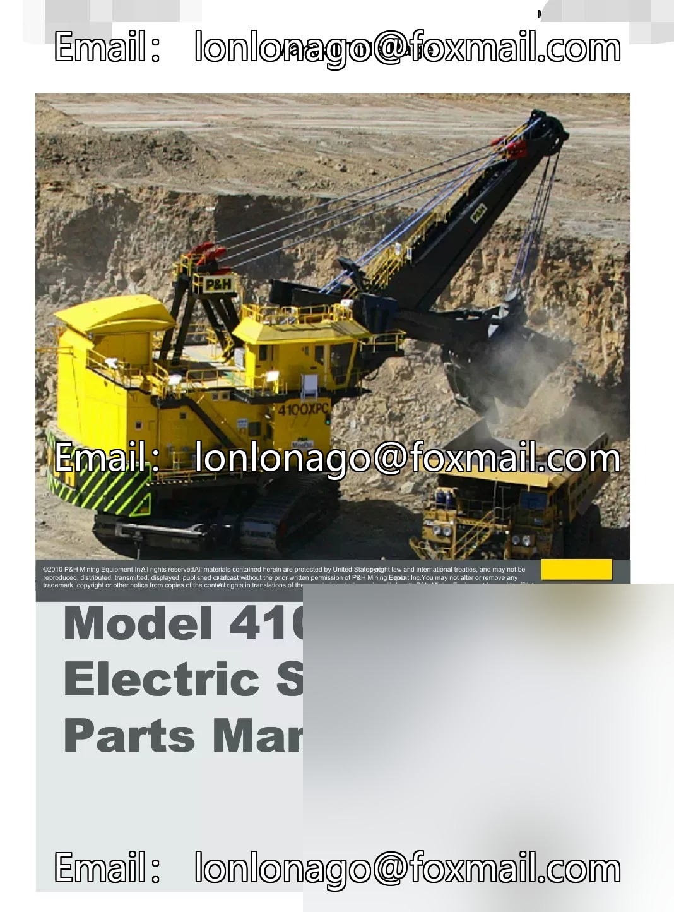
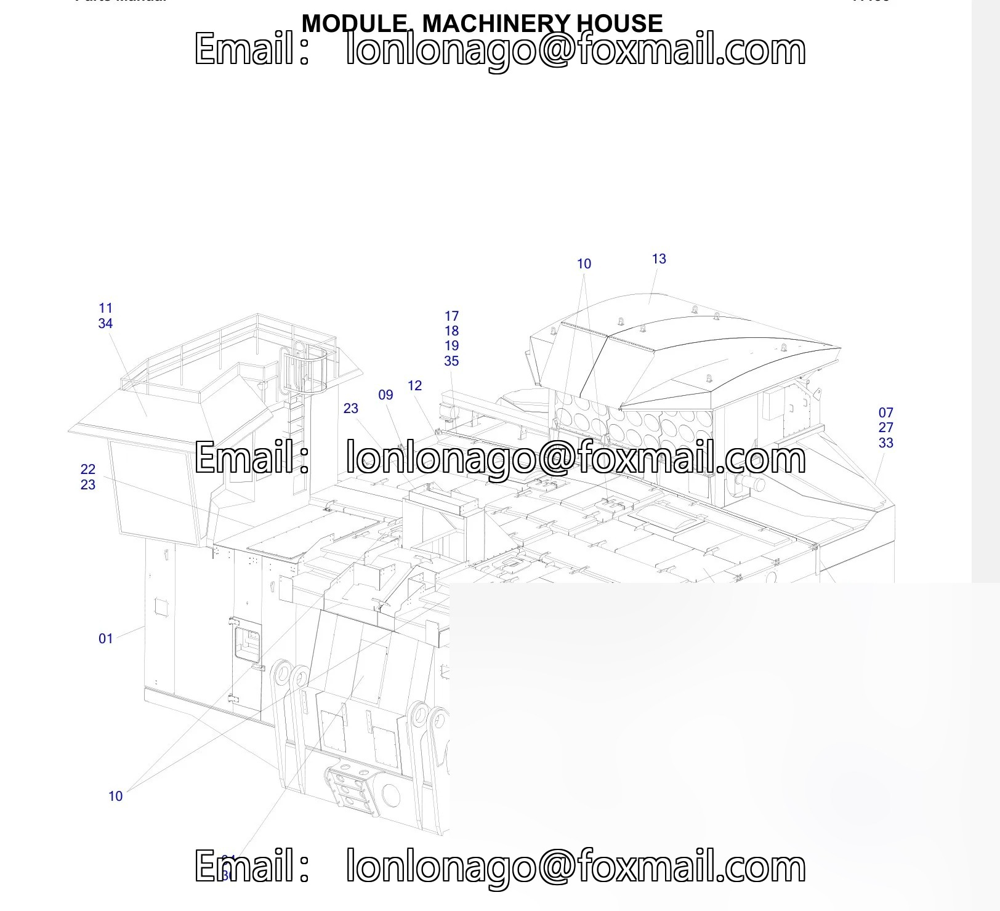
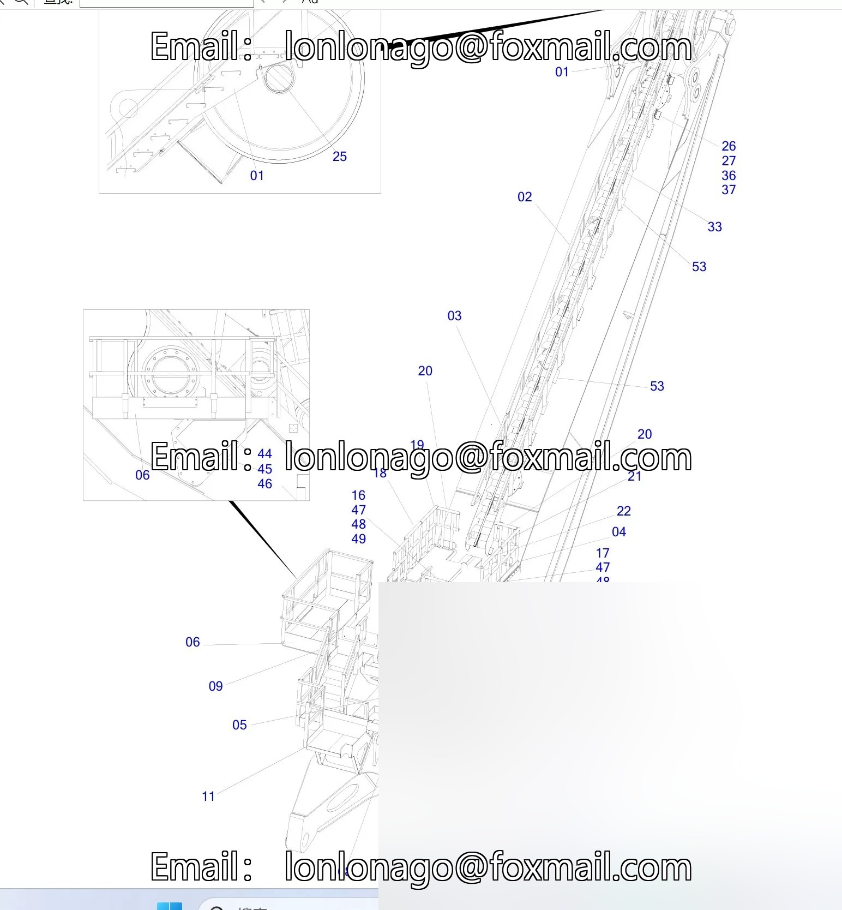

# P&H 4100XPC design materials

## Body

P&H 4100XPC design materials; P&H 4100XPC mining electric front scraper official "Part Manual", 1000-page PDF .
U.S. original materials; content covers core parts, structure, function of mining excavators, suitable for engineering, machinery, maintenance, collection and other professional uses.
refunded upon sale.

The material is P&H 4100XPC design assets including the official Parts Manual in 1,000-page PDF format, covering mining excavator core parts, structure and function, and suited to engineering, machinery, repair and collection professions.

<!-- AI_ENRICHED -->

## Images

## Payment

Here is a pay link on Stripe ( https://buy.stripe.com/3cs8yP7sY87d0vu9AB ). Please contact me lonlonago@foxmail.com after funding $89, and I will send you a complete data files , thank you!

